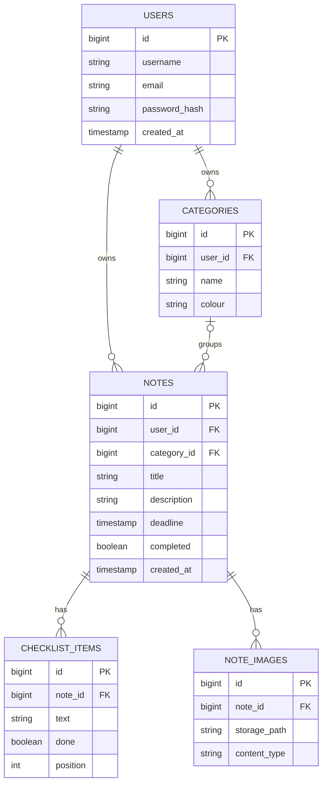

# NoteIt

NoteIt is a web app for keeping track of assignments and to-do lists. Notes can be grouped into coloured categories, given deadlines, filled with checklist items, and decorated with pictures. Notes whose deadline has passed are marked as overdue automatically.

> **Status:** early development. The project is generated and connected to the database. The features below are planned and are being built in the order listed under [Roadmap](#roadmap).

## Features

Planned for the first version:

- Create an account and log in
- Create categories with a name and a colour, and delete them
- Create notes with a title, description, and optional deadline
- Add a checklist of to-do items inside a note and tick them off
- Attach pictures to a note
- Automatically mark notes as overdue when the deadline passes
- Delete notes

## Tech stack

| Part | Choice |
|---|---|
| Language | Java 21 or newer |
| Framework | Spring Boot 4.1.x (Spring MVC) |
| Build tool | Maven |
| Database | PostgreSQL, hosted on Supabase |
| Data access | Spring Data JPA (Hibernate) |
| Frontend | Thymeleaf templates, Bootstrap, and plain JavaScript (`fetch`) for updates without page reloads |
| Security | Spring Security (planned), with BCrypt password hashing |
| Image storage | Supabase Storage (planned) |

## Project structure

```
NoteIt/
├── pom.xml
├── README.md
├── .gitignore
└── src/
    ├── main/
    │   ├── java/com/example/NoteIt/
    │   │   ├── NoteItApplication.java
    │   │   ├── model/          entities (database tables)
    │   │   ├── repository/     database access interfaces
    │   │   ├── service/        business rules
    │   │   ├── controller/     page and JSON endpoints
    │   │   ├── dto/            request and response objects
    │   │   ├── config/         security and other configuration
    │   │   └── exception/      custom errors and their handler
    │   └── resources/
    │       ├── application.properties
    │       ├── application-local.properties    (not committed)
    │       ├── templates/      Thymeleaf pages
    │       └── static/         css and js
    └── test/
```

A request travels through the layers in one direction:

```
Browser -> Controller -> Service -> Repository -> Database
```

Controllers handle HTTP only, services hold the business rules, and repositories talk to the database. Entities are never sent to the browser directly, DTOs are used instead.

## Database design



Design decisions:

- **Overdue is calculated, not stored.** A note is overdue when its deadline has passed and it is not completed.
- **Deleting a category keeps its notes.** They become uncategorised.
- **Deleting a note** also deletes its checklist items and images.
- **The users table is named `users`**, because `user` is a reserved word in PostgreSQL.
- **Images are stored in Supabase Storage.** The database only keeps the file path.

## Getting started

### Prerequisites

- JDK 21 or newer
- IntelliJ IDEA (or any IDE with Maven support)
- A Supabase project (the free plan is enough)

### 1. Clone the project

```
git clone <your-repository-url>
cd NoteIt
```

Open the folder in IntelliJ (File > Open, select `pom.xml`, choose "Open as Project") and wait for Maven to finish importing.

### 2. Get the database connection details

In the Supabase dashboard, click **Connect**, choose **Direct Connection string**, set the type to **JDBC**, and select the **Session pooler** connection method.

Use the session pooler instead of the direct connection. The direct connection uses IPv6 by default and fails with `No route to host` on IPv4-only networks.

Note these values from the dashboard:

| Value | Example shape |
|---|---|
| Host | `aws-0-<region>.pooler.supabase.com` |
| Port | `5432` |
| Database | `postgres` |
| User | `postgres.<your-project-ref>` (note the dot and the project reference) |
| Password | the database password you set for the project |

### 3. Configure the application

`src/main/resources/application.properties` is committed and contains only placeholders:

```properties
spring.application.name=NoteIt
spring.datasource.url=jdbc:postgresql://${DB_HOST}:${DB_PORT:5432}/${DB_NAME:postgres}?sslmode=require
spring.datasource.username=${DB_USER}
spring.datasource.password=${DB_PASSWORD}
spring.jpa.hibernate.ddl-auto=update
spring.jpa.show-sql=true
```

Create `src/main/resources/application-local.properties` for your own values. This file is listed in `.gitignore` and must never be committed:

```properties
DB_HOST=aws-0-<region>.pooler.supabase.com
DB_PORT=5432
DB_NAME=postgres
DB_USER=postgres.<your-project-ref>
DB_PASSWORD=<your-database-password>
```

### 4. Activate the local profile

In IntelliJ, open the run configuration (Edit Configurations), select the NoteIt application, and set **Active profiles** to `local`. If the field is hidden, add it through Modify options.

Alternatively, from the terminal:

```
./mvnw spring-boot:run -Dspring-boot.run.profiles=local
```

### 5. Run

Run `NoteItApplication` from the IDE, or use the Maven command above. A successful start ends with a line like `Started NoteItApplication in ... seconds`. Then open <http://localhost:8080>.

Hibernate creates the tables in Supabase on the first run with entities present. You can check them in the Supabase Table Editor.

## Troubleshooting

| Error | Likely cause |
|---|---|
| `No route to host` or `UnknownHostException` | The direct connection host is IPv6 only. Use the Session pooler host. |
| `Tenant or user not found` | The username is missing the `.<project-ref>` part, or the pooler host does not match the project region. |
| `password authentication failed` | Wrong password. Reset it under "Reset database password" in the Connect panel. |
| `Cannot find template location` warning | No templates exist yet. It disappears once `templates/` contains a page. |

## Roadmap

- [x] Generate the project and connect it to Supabase
- [ ] Entities and repositories (`User`, `Category`, `Note`, `ChecklistItem`, `NoteImage`)
- [ ] Registration and login with Spring Security
- [ ] Categories: create, list, delete
- [ ] Notes with deadlines and automatic overdue status
- [ ] Checklist items inside notes
- [ ] Image upload through Supabase Storage

## Notes for contributors

- Never commit passwords or `application-local.properties`. If a password was ever committed, reset it in Supabase.
- Keep controllers thin. Business rules belong in the `service` package.
- Do not return entities from controllers. Use DTOs.
